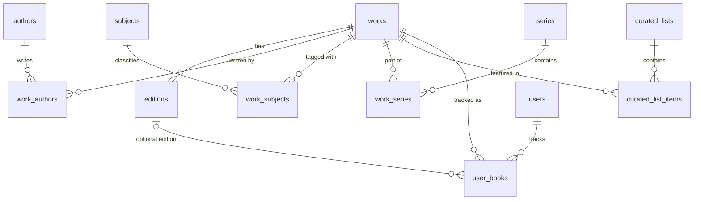

# 📚 Padhante: Book Recommendation Site & Community Library

Padhante is a responsive web application for discovering books, getting recommendations, and tracking your personal reading. Users can browse genre shelves and curated collections, search the catalog, and keep private shelves of what they are reading, want to read, or have finished.

**Live demo:** https://book-recommendation-site-theta.vercel.app
**Status:** Prototype (v0.1.0). See [Project Status](#project-status) and [Known Limitations](#known-limitations) before using it with real users.

---

## Table of Contents

1. [Features](#features)
2. [Tech Stack](#tech-stack)
3. [Getting Started](#getting-started)
4. [Available Scripts](#available-scripts)
5. [Project Structure](#project-structure)
6. [Architecture Overview](#architecture-overview)
7. [Recommendation System](#recommendation-system)
8. [Database](#database)
9. [Deployment](#deployment)
10. [Project Status](#project-status)
11. [Known Limitations](#known-limitations)
12. [Roadmap](#roadmap)
13. [Contributing](#contributing)
14. [License](#license)

---

## Features

| Area | Description |
|------|-------------|
| **Book discovery** | Browse genre shelves, curated collections, and carousel views. |
| **3D coverflow hero** | Interactive 3D coverflow carousel highlighting popular and classic literature. |
| **Recommendations** | Contextual and genre-based book recommendations. |
| **Search** | Instant catalog search with responsive filtering. |
| **Demo accounts** | Sign up and sign in with a name, email and password. Accounts are stored in the browser's `localStorage` (client-side demo, not server-backed). Reader preferences (genres, interests, reading goal) are saved with the account. |
| **Reading shelves** | Track books you are reading, want to read, or have completed. |
| **Modern UI** | Tailwind CSS styling, Lucide icons, and Motion (Framer Motion) transitions. |

## Tech Stack

| Layer | Technology |
|-------|-----------|
| Framework | [Next.js 15](https://nextjs.org/) (App Router) |
| UI library | [React 19](https://react.dev/) |
| Language | [TypeScript](https://www.typescriptlang.org/) |
| Styling | [Tailwind CSS 3](https://tailwindcss.com/), `clsx`, `tailwind-merge` |
| Icons & animation | [Lucide React](https://lucide.dev/), [Motion](https://motion.dev/) |
| Database | [PGlite](https://pglite.dev/) (embedded Postgres) |
| ORM & migrations | [Drizzle ORM](https://orm.drizzle.team/) and Drizzle Kit |
| Validation | [Zod](https://zod.dev/) |
| Tooling | `tsx` (script runner), PostCSS, Autoprefixer, `dotenv` |
| Recommendation scripts | Node.js and Python |
| Hosting | [Vercel](https://vercel.com/) |

## Getting Started

### Prerequisites

- [Node.js](https://nodejs.org/) v18 or higher (v20+ recommended)
- npm (bundled with Node.js)
- Python 3 (only needed to regenerate book embeddings, see [Recommendation System](#recommendation-system))

### Installation

```bash
# 1. Clone the repository
git clone https://github.com/DiwashGopalSingh/Book-Recommendation-Site.git
cd Book-Recommendation-Site

# 2. Install dependencies
npm install

# 3. Create the database schema and load the catalog
npm run db:migrate
npm run db:seed

# 4. Start the development server
npm run dev
```

Open [http://localhost:3000](http://localhost:3000) in your browser.

### Environment variables

`dotenv` is installed for local configuration. If you add secrets or service URLs, keep them in a `.env` file at the project root. This file is git-ignored and must never be committed. Document each variable here (name, purpose, example) as you introduce it.

## Available Scripts

| Command | Description |
|---------|-------------|
| `npm run dev` | Start the local Next.js development server. |
| `npm run build` | Create a production build. |
| `npm run start` | Run the production server (after `build`). |
| `npm run lint` | Run ESLint checks. |
| `npm run db:migrate` | Apply database migrations (`src/lib/db/migrate.ts`). |
| `npm run db:seed` | Seed the local database with catalog books (`src/lib/db/seed.ts`). |
| `npm run reco:build` | Build the book similarity matrix (`scripts/build-similarity-matrix.js`). |
| `npm run reco:py` | Generate book embeddings with Python (`scripts/generate-book-embeddings.py`). |

## Project Structure

```
Book-Recommendation-Site/
├── .vscode/                  Editor settings
├── drizzle/                  Generated SQL migrations
├── public/                   Static assets (images, covers)
├── scripts/                  Recommendation data-generation scripts
│   ├── build-similarity-matrix.js
│   └── generate-book-embeddings.py
├── src/                      Application source (Next.js App Router)
│   └── lib/
│       └── db/               Database layer: schema, migrate, seed
├── fetch-covers.js           One-off scripts that download book covers
├── fetch-more-covers.js
├── fetch-penguin-covers.js
├── drizzle.config.ts         Drizzle Kit configuration
├── next.config.mjs           Next.js configuration
├── tailwind.config.js        Tailwind configuration
├── postcss.config.js         PostCSS configuration
├── tsconfig.json             TypeScript configuration
└── package.json
```

<!-- VERIFY: add the contents of src/ (app routes, components, API routes) once finalized. -->

## Architecture Overview

```
 Browser
    │
    ▼
 Next.js 15 (App Router, React 19)
    │   ├── Pages & components (Tailwind, Motion)
    │   └── Server logic (validation with Zod)
    ▼
 Drizzle ORM
    ▼
 PGlite (embedded Postgres)  ◄── seeded with catalog data
```

Recommendation data (similarity matrix and embeddings) is generated offline by the scripts in `scripts/` and consumed by the application at runtime.

## Recommendation System

The project supports two kinds of recommendations:

- **Genre-based and contextual recommendations** shown on shelves and collections.
- **Similar-book recommendations** ("if you liked this, try these"), driven by precomputed data.

The offline pipeline has two steps:

1. `npm run reco:py` runs `scripts/generate-book-embeddings.py`, which produces vector embeddings for books.
2. `npm run reco:build` runs `scripts/build-similarity-matrix.js`, which builds the similarity matrix used to find related books.

<!-- VERIFY: confirm the exact inputs/outputs of each script, the order they must run in, the Python dependencies required (add a requirements.txt), and where the generated files are stored. -->

## Database

- **Engine:** PGlite, an embedded, in-process Postgres.
- **ORM:** Drizzle, with the schema defined in `src/lib/db/schema.ts`.
- **Migrations:** generated into `drizzle/` and applied with `npm run db:migrate`.
- **Local storage:** data is written to `./.pglite_data` (configured in `drizzle.config.ts`). This directory is local state and should be git-ignored.
- **Seeding:** `npm run db:seed` loads the catalog books.

To reset your local database, stop the dev server, delete `.pglite_data`, then re-run `db:migrate` and `db:seed`.

### Data model

The schema (`src/lib/db/schema.ts`) has 14 tables in three groups.



**Catalog**

| Table | Purpose |
|-------|---------|
| `works` | The abstract book (title, description, first publish year, audience level, quality score, publish status). |
| `editions` | A concrete publication of a work (ISBN-10/13, publisher, page count, format, cover URL, cover source and attribution). |
| `authors` | Author name, slug and bio. |
| `work_authors` | Links works to authors, with a `role` (author, translator, illustrator) and display `position`. |
| `subjects` | Genres and subjects, with a normalized key for deduplication. |
| `work_subjects` | Links works to subjects. |
| `series` / `work_series` | Book series and each work's position within a series. |
| `external_ids` | Maps internal records to external sources (Open Library, Google Books, Gutenberg) for traceability and deduplication, with a terms-of-use note. |

**Curation**

| Table | Purpose |
|-------|---------|
| `curated_lists` | Staff-curated collections (title, description, audience level, language, draft/published/archived status). |
| `curated_list_items` | Works in a list, with an order and an optional curator note. |

**Users and reading tracker**

| Table | Purpose |
|-------|---------|
| `users` | Accounts with a type (`member`, `managed`, `staff`, `admin`), display name, optional email, password hash, language preferences, an audience ceiling, and an account status. |
| `user_books` | A user's private shelf entry for a work: status (`want_to_read`, `reading`, `read`, `did_not_finish`), rating, reading progress (pages and percent), start and finish dates, and a private note. One row per user and work. |

**Design decisions**

- **Work and edition are separate.** A single book can have many editions (formats, languages, publishers), and shelves, ratings and recommendations attach to the work.
- **Privacy by design.** Users store no date of birth or phone number. Ratings and notes are private to each user, and there are no public reviews.
- **Age-appropriate access.** Every work has an `audience_level`, and every user has an `audience_ceiling`. The `managed` account type supports child accounts without an email address, linked to a manager through `managed_by`.
- **Traceable catalog data.** `external_ids`, `cover_source`, `cover_attribution` and `description_source` record where each piece of data came from.
- **Moderation.** `status` on works (`draft`, `published`, `hidden`) and `manually_edited` let staff hide records and protect manual edits from being overwritten by re-imports.

> **Note:** the schema has no tables for sessions, password-reset or email-verification tokens, and no table for book text content. See [Known Limitations](#known-limitations).

## Deployment

The demo is deployed on [Vercel](https://vercel.com/).

> **Important:** PGlite stores data on the local filesystem. Vercel's serverless runtime does not provide persistent writable storage, so data created on the deployed site (accounts, shelves) may not persist between requests. For a production deployment, use a hosted Postgres service (for example Neon, Supabase, or Vercel Postgres). Because the project uses Drizzle, the change is limited mostly to the database connection and driver.

Production build checklist:

```bash
npm run lint
npm run build
npm run start
```

## Project Status

Padhante is an early-stage prototype (v0.1.0). The discovery, search, and UI experience are built. The following areas are not yet production-ready:

- Authentication is a client-side demo (accounts live in the browser's `localStorage`). Server-side authentication and authorization are not implemented yet.
- Persistent storage for the deployed site.
- Automated tests and continuous integration.

## Known Limitations

- **Authentication is a client-side demo, not real security.** Sign-up, sign-in and session handling run entirely in the browser:
  - Accounts, including passwords in plain text, are kept in `localStorage` under `registered_accounts`.
  - A session is a `cl_session` cookie plus a `library_user` entry in `localStorage`. Neither is signed or verified by a server, so the login gate can be bypassed from the browser's developer tools.
  - Accounts exist only in the browser where they were created: they do not follow the user to another device, and clearing browser data deletes them.
  - The `users` table in the database schema is not connected to this sign-in flow.
  - **Do not use a real or reused password on the demo.** Do not deploy this for real users until server-side authentication replaces it.
- **Data persistence on Vercel:** see [Deployment](#deployment).
- **Catalog:** books come from a seeded dataset. Cover images and metadata should be checked for licensing and attribution before public launch.
- **Sessions and account recovery:** the schema has no sessions, password-reset, or email-verification tables, and the current auth does not use a server. Password recovery, email verification and cross-device sign-in are not supported.
- **Role enforcement:** the schema defines `staff` and `admin` account types, but role-based access checks must be enforced in application code.
- **Online reading:** the schema stores no book text, so full-text reading is not supported by the current data model.
- **Data integrity:** some rules described in code comments (for example half-star ratings from 0.5 to 5.0 and progress percent from 0 to 100) are not enforced by database constraints yet.
- **Tests:** there is no automated test suite yet.
- **Setup scripts:** the three `fetch-*covers.js` scripts in the repository root are one-off utilities and are not part of the normal setup.

## Roadmap

- [ ] Replace PGlite with hosted Postgres for production
- [ ] Replace the `localStorage` demo auth with server-side authentication from a maintained library (for example Auth.js or Better Auth), backed by the `users` table, with hashed passwords, `HttpOnly` session cookies, and per-user ownership checks on all shelf and rating data
- [ ] Move shelves, ratings and preferences from the browser to the database so they follow the user across devices
- [ ] Add database constraints for ratings, progress, and age-ceiling rules (the schema already stores ratings and progress; confirm they are fully wired into the UI)
- [ ] Add session, password-reset and email-verification support
- [ ] Add foreign keys for `users.managed_by` and `curated_lists.created_by`
- [ ] Personalized recommendations based on a user's ratings and shelves
- [ ] Integrate an open catalog source (for example Open Library) instead of a fixed seed
- [ ] Add `.env.example` and a documented list of environment variables
- [ ] Add unit and integration tests
- [ ] Add a CI workflow (lint, type-check, build) with GitHub Actions
- [ ] Move one-off cover scripts into `scripts/` and document them
- [ ] Add accessibility and performance audits

## Contributing

Contributions and feedback are welcome.

1. Fork the repository and create a feature branch: `git checkout -b feature/my-change`
2. Make your changes and run `npm run lint` and `npm run build`.
3. Commit with a clear message and open a pull request describing what changed and why.

## License

This project is licensed under the [MIT License](LICENSE).
